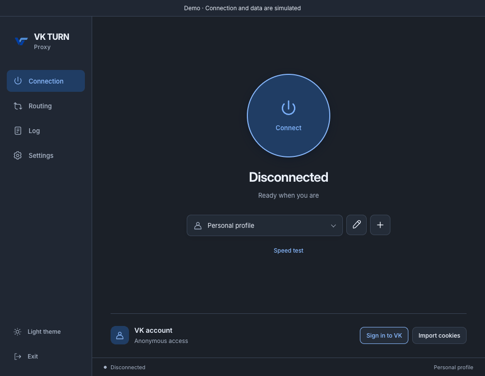

[Русский](README.md) · [English](README.en.md)

# VK TURN Proxy Desktop

This project was created for educational and research purposes.

VPN client for Windows, Linux and macOS that sends WireGuard traffic through VK TURN relays.

[](https://artemk1337.github.io/vk-turn-proxy-desktop/?lang=en)

[Try the interface](https://artemk1337.github.io/vk-turn-proxy-desktop/?lang=en)

## Install

Download the **amd64 (x64)** or **arm64** package from the releases page. [Download](https://github.com/artemk1337/vk-turn-proxy-desktop/releases/latest)

### Windows

Run `*-setup.exe`. For portable use, extract the ZIP and open `vk-turn-proxy-windows.exe`, keeping both executables and `wintun.dll` together. The app offers to install WebView2 if needed. Approve the administrator prompt when connecting.

### Linux

On Debian or Ubuntu, install the `.deb` and open **VK TURN Proxy** from the applications menu

```sh
sudo apt install ./vk-turn-proxy-linux-v1.15.2-amd64.deb
```

For portable use, extract the `.tar.gz` and run `./vk-turn-proxy-desktop`. Requires GTK 3, WebKitGTK 4.1, iproute2 and polkit. Website login also requires Python 3, PyGObject and `gir1.2-webkit2-4.1`.

### macOS

Requires macOS 12 or later. Extract the ZIP for Apple Silicon (**arm64**) or Intel (**amd64**) and move **VK TURN Proxy.app** to Applications. Approve system helper installation on the first connection. First launch may require approval in System Settings → Privacy & Security.

## Connect

1. Click **Add profile** and paste a link, JSON/Base64 or a WireGuard config with a VK call invitation.
2. Save the profile. Use **Sign in to VK** or import cookies if required.
3. Select the profile and click **Connect**.

Language, theme and autostart are in **Settings**. Choose **Exit** from the tray to close the app.

## Documentation

- [User guide](docs/guide.en.md) covers installation and removal, profiles, routing, speed tests, logs and terminal use.
- [Build](docs/build.en.md) contains commands for Windows, Linux and macOS.

## Related projects

Shared transport code comes from anton48’s project. [iOS client](https://github.com/anton48/vk-turn-proxy-ios) · [Server](https://github.com/anton48/vk-turn-proxy)

[GPL-3.0](LICENSE). See [NOTICE.md](NOTICE.md) for third-party licenses and attribution.
