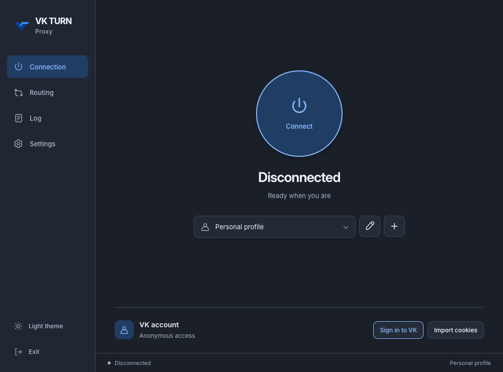

# VK TURN Proxy Desktop

Desktop VPN client that sends WireGuard traffic through VK TURN relays. Available for Windows, Linux and macOS. Supports profile links, WireGuard configs, VK login, tray controls and autostart. Shared Wails interface with English and Russian, light and dark themes, and reduced-motion support.

[Русский](README.ru.md)



## Install

Download the package for **amd64 (x64)** or **arm64** from [Releases](https://github.com/artemk1337/vk-turn-proxy-desktop/releases/latest).

### Windows

- **Installer** — run `*-setup.exe`. The app and terminal wizard appear in the Start menu.
- **Portable** — extract the ZIP and run `vk-turn-proxy-windows.exe`. Keep both executables and `wintun.dll` together.

The desktop app requires Microsoft Edge WebView2 Runtime and offers to install it when missing. [Download Runtime](https://developer.microsoft.com/microsoft-edge/webview2/)

Approve the administrator prompt to manage the VPN tunnel.

### Linux

Install the `.deb` on Debian or Ubuntu and open **VK TURN Proxy** from the applications menu

```sh
sudo apt install ./vk-turn-proxy-linux-v1.9.0-amd64.deb
```

For portable use, extract the `.tar.gz` and run `./vk-turn-proxy-desktop`. It requires GTK 3, WebKitGTK 4.1, iproute2 and polkit. Website login additionally uses Python 3, PyGObject and `gir1.2-webkit2-4.1`. The app requests administrator access when connecting.

### macOS

Download the **arm64** ZIP for Apple Silicon or **amd64** for Intel. Extract it and move **VK TURN Proxy.app** to Applications. Requires macOS 12 or later. The first connection requests administrator authorization to install a system helper. Later connections use the installed helper without another password prompt. Updating the helper requires authorization again. Disconnecting or exiting restores network settings.

Use **Sign in to VK** to authenticate in an isolated system WKWebView window, or **Import cookies** to load an existing session. The macOS packages use ad-hoc signing. First launch can require approval in System Settings → Privacy & Security. To remove the app, disconnect, turn off **Launch at sign-in**, remove the system helper with the command below, and delete the application.

```sh
sudo /Library/PrivilegedHelperTools/io.github.artemk1337.vkturnproxy.helper --desktop-helper-uninstall
```

## Connect

In **Connection**, click **Add profile**, choose a profile link/JSON or a WireGuard config with a VK call invitation, then save. Switch saved profiles from the list and click **Connect**. Plain JSON and Base64 are also accepted. The desktop app supports adding, editing and removing named profiles.
For manual setup, use the TURN address (usually `host:56000`) or leave it empty to use `Endpoint`. Select SRTP or DTLS to match your server.

Manual configs require one peer, IPv4 and `AllowedIPs = 0.0.0.0/0`. SRTP requires the server’s `-srtp` option.

**Sign in to VK** is on the main screen and applies to all profiles. The session is saved separately and checked every five minutes. **Cookies** accepts a Netscape file or `remixsid=…; p=…`. Website login requires [WebView2 Runtime](https://developer.microsoft.com/microsoft-edge/webview2/) on Windows or WebKitGTK (`gir1.2-webkit2-4.1`) on Linux.

**Settings** contains language, theme, autostart and the log limit on all platforms. The log retains 1000 lines by default, adjustable from 100 to 10,000, with a separate 4 MiB cap. Closing the window hides it in the tray when available. **Exit** disconnects and closes the app.

## Speed test and traffic

Click **Speed test** below the profile selector and choose a server or automatic selection. The test measures latency and average download/upload speed over six seconds per direction using three parallel streams. Each direction has a progress bar, and **Stop test** cancels the measurement.

The test follows current system routing. It can run with the VPN disconnected. With split tunneling, the selected test server can use the direct connection.

While connected, the bottom status bar shows current download and upload traffic in Mbit/s, refreshed once per second.

## Routing

Open **Routing**, select a saved profile and choose a mode

- **All through VPN** sends all traffic through the tunnel.
- **VPN with exceptions** sends selected networks and sites directly.
- **Selected through VPN** sends selected networks and sites through the tunnel and other traffic directly.

Add custom domains, IPv4 addresses or CIDR subnets. **GeoIP regions** selects networks by country. **GeoSite sets** selects groups of domains. Each opens a separate searchable window with subgroups and multiple selection. Confirm the selection, then save the profile's routing settings. Changes take effect on the next connection. **Local network always direct** keeps local destinations outside the tunnel.

Click **Synchronize** to download the GeoIP and GeoSite databases. Automatic updates run daily while the app is open. A failed update retains the last downloaded databases. The sources are [Loyalsoldier GeoIP](https://github.com/Loyalsoldier/geoip) and [Loyalsoldier GeoSite](https://github.com/Loyalsoldier/v2ray-rules-dat).

Routing supports IPv4. IPv6 remains blocked while connected. Domain rules use system DNS through a local UDP/TCP forwarder on `127.0.0.1:53`. Applications using their own DoH/DoT resolver or cached DNS answers can bypass domain rules. Learned IP routes remain until disconnect, so sites sharing an IP share its route.

## Terminal

On Windows, open **Terminal setup** from the Start menu, or run PowerShell as Administrator in the portable folder

```powershell
.\vk-turn-proxy-console.exe -wizard
```

On Linux, run the installed terminal client

```sh
sudo vk-turn-proxy-console -wizard
```

On macOS, use the terminal client inside the application bundle

```sh
sudo "/Applications/VK TURN Proxy.app/Contents/MacOS/vk-turn-proxy-console" -wizard
```

For the Linux portable package, use `sudo ./vk-turn-proxy-console -wizard`. Follow the setup steps. Press **Ctrl+C** to disconnect. Add `-vk-cookie-file .\cookies.txt` if your profile requires VK login.

For resolved routing rules, add `-routing-file routing.json -block-ipv6`. The JSON policy contains `mode` (`include` or `exclude`), IPv4 `prefixes`, `domains` with `type` (`full`, `domain`, `plain` or `regex`) and `value`, and `localDirect`. GeoIP and GeoSite selections are resolved into this policy by the desktop app.

## Build

The desktop applications embed the same HTML/CSS/JavaScript frontend in a Wails v2 Go executable. The frontend is bundled with the application, including its fonts, and requires no Node.js build step. Linux builds use CGO with GTK 3 and WebKitGTK 4.1. Docker builds both CPU architectures with native toolchains through buildx emulation.


```sh
docker build --build-arg VERSION=v1.9.0 --build-arg RUN_TESTS=false --output dist/windows -f Dockerfile.windows .
docker build --target packages --build-arg VERSION=v1.9.0 --build-arg RUN_TESTS=false --output dist/linux -f Dockerfile.linux .
```

Produces Windows ZIPs/installers and Linux archives/DEB packages for x64 and ARM64, with checksums.

Build macOS packages on a Mac with Xcode Command Line Tools and the Apple SDK

```sh
sh installer/macos/package.sh v1.9.0 dist/macos
```

Produces ad-hoc signed application ZIPs for Intel and Apple Silicon with checksums.

## Related projects

Shared transport code comes from anton48’s project. [iOS client](https://github.com/anton48/vk-turn-proxy-ios) · [Server](https://github.com/anton48/vk-turn-proxy)

[GPL-3.0](LICENSE). Dependency license notices are included in the packages.
