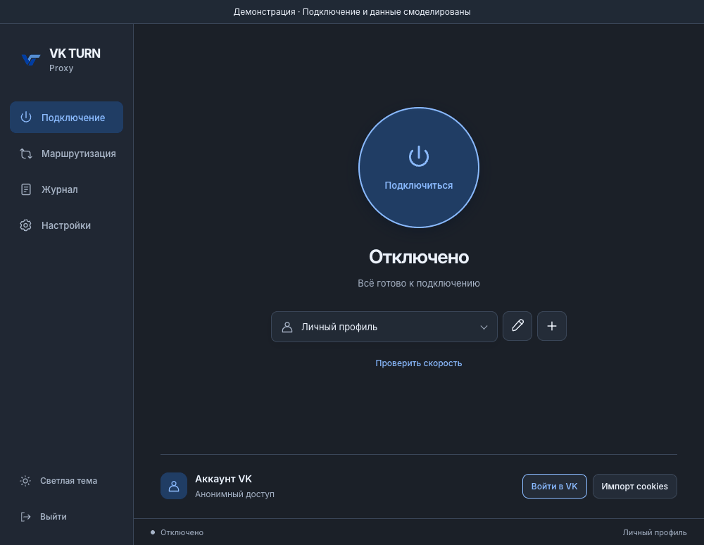

[Русский](README.md) · [English](README.en.md)

# VK TURN Proxy Desktop

VPN-клиент для Windows, Linux и macOS с передачей трафика WireGuard через TURN-серверы VK.

[](https://artemk1337.github.io/vk-turn-proxy-desktop/?lang=ru)

[Попробовать интерфейс](https://artemk1337.github.io/vk-turn-proxy-desktop/?lang=ru)

## Установка

Скачайте пакет для **amd64 (x64)** или **arm64** со страницы релизов. [Скачать](https://github.com/artemk1337/vk-turn-proxy-desktop/releases/latest)

### Windows

Запустите `*-setup.exe`. Для portable-версии распакуйте ZIP и откройте `vk-turn-proxy-windows.exe`, сохранив оба `.exe` и `wintun.dll` в одной папке. Если WebView2 отсутствует, приложение предложит его установить. Подтвердите запрос администратора при подключении.

### Linux

В Debian или Ubuntu установите `.deb` и откройте **VK TURN Proxy** из меню приложений

```sh
sudo apt install ./vk-turn-proxy-linux-v1.14.0-amd64.deb
```

Для portable-версии распакуйте `.tar.gz` и запустите `./vk-turn-proxy-desktop`. Нужны GTK 3, WebKitGTK 4.1, iproute2 и polkit. Для входа в VK через сайт также нужны Python 3, PyGObject и `gir1.2-webkit2-4.1`.

### macOS

Нужна macOS 12 или новее. Распакуйте ZIP для Apple Silicon (**arm64**) или Intel (**amd64**) и перенесите **VK TURN Proxy.app** в «Программы». При первом подключении подтвердите установку системного помощника. Первый запуск может потребовать разрешения в «Системные настройки → Конфиденциальность и безопасность».

## Подключение

1. Нажмите **Добавить профиль** и вставьте ссылку, JSON/Base64 или WireGuard-конфиг с приглашением в VK-звонок.
2. Сохраните профиль. При необходимости нажмите **Войти в VK** или импортируйте cookies.
3. Выберите профиль и нажмите **Подключиться**.

Язык, тема и автозапуск доступны в **Настройках**. Для завершения работы выберите **Выход** в трее.

## Документация

- [Руководство](docs/guide.ru.md) — установка и удаление, профили, маршрутизация, проверка скорости, журнал и работа в терминале.
- [Сборка](docs/build.ru.md) — команды для Windows, Linux и macOS.

## Связанные проекты

Общий код транспорта взят из проекта anton48. [Клиент для iOS](https://github.com/anton48/vk-turn-proxy-ios) · [Сервер](https://github.com/anton48/vk-turn-proxy)

[GPL-3.0](LICENSE). Лицензии зависимостей входят в пакеты.
