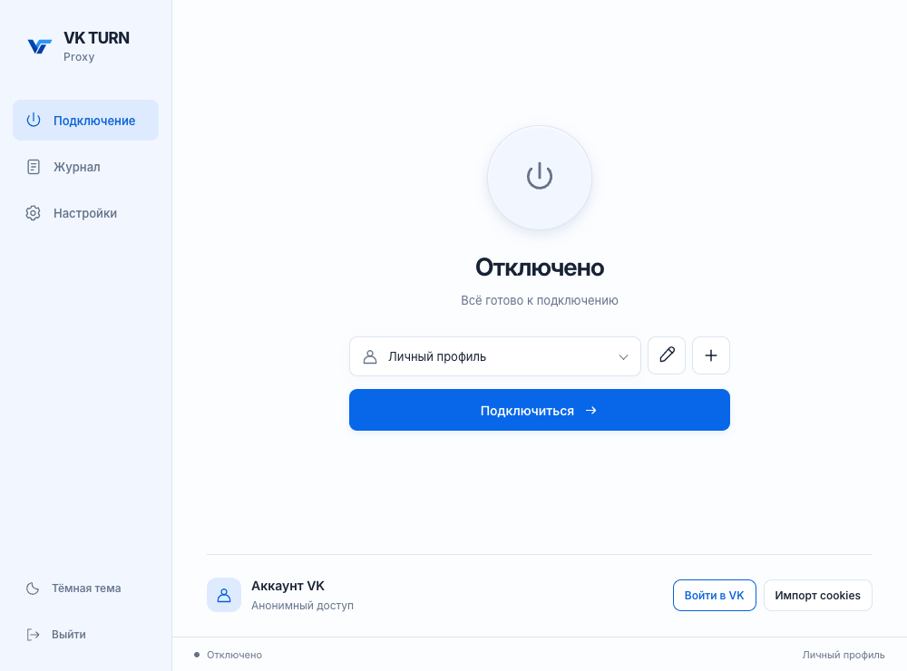

# VK TURN Proxy Desktop

Настольный VPN-клиент, который передаёт трафик WireGuard через TURN-серверы VK. Доступен для Windows, Linux и macOS. Поддерживает ссылки профилей, WireGuard-конфиги, вход в VK, управление из трея и автозапуск. Общий интерфейс на Wails поддерживает русский и английский языки, светлую и тёмную темы, а также уменьшение анимации.

[English](README.md)



## Установка

Скачайте пакет для **amd64 (x64)** или **arm64** из [Releases](https://github.com/artemk1337/vk-turn-proxy-desktop/releases/latest).

### Windows

- **Установщик** - запустите `*-setup.exe`. Приложение и мастер настройки в терминале появятся в меню «Пуск».
- **Portable** - распакуйте ZIP и запустите `vk-turn-proxy-windows.exe`. Оставьте оба `.exe` и `wintun.dll` в одной папке.

Для графического интерфейса нужен Microsoft Edge WebView2 Runtime. Если он отсутствует, приложение предложит установку. [Скачать Runtime](https://developer.microsoft.com/microsoft-edge/webview2/)

Подтвердите запрос администратора для управления VPN-туннелем.

### Linux

Установите `.deb` в Debian или Ubuntu и откройте **VK TURN Proxy** из меню приложений

```sh
sudo apt install ./vk-turn-proxy-linux-v1.9.0-amd64.deb
```

Для portable-версии распакуйте `.tar.gz` и запустите `./vk-turn-proxy-desktop`. Нужны GTK 3, WebKitGTK 4.1, iproute2 и polkit. Для входа через сайт дополнительно нужны Python 3, PyGObject и `gir1.2-webkit2-4.1`. При подключении приложение запросит права администратора.

### macOS

Скачайте ZIP **arm64** для Apple Silicon или **amd64** для Intel. Распакуйте архив и перенесите **VK TURN Proxy.app** в «Программы». Нужна macOS 12 или новее. При первом подключении приложение запросит права администратора для установки системного помощника. Следующие подключения используют установленный помощник без повторного ввода пароля. При обновлении помощника подтверждение потребуется снова. При отключении и выходе приложение восстановит настройки сети.

Для авторизации нажмите **Войти в VK**. Вход откроется в отдельном окне системного WKWebView с временной сессией. Через **Импорт cookies** можно загрузить существующую сессию. Сборки macOS подписаны ad-hoc. Первый запуск может потребовать подтверждения в «Системные настройки → Конфиденциальность и безопасность». Для удаления отключитесь, выключите **Запуск при входе**, удалите системный помощник командой ниже и удалите приложение.

```sh
sudo /Library/PrivilegedHelperTools/io.github.artemk1337.vkturnproxy.helper --desktop-helper-uninstall
```

## Подключение

В разделе **Подключение** нажмите **Добавить профиль**, выберите ссылку/JSON профиля или WireGuard-конфиг с приглашением в VK-звонок и сохраните. Выберите профиль из списка и нажмите **Подключиться**. Можно вставить JSON или Base64. В приложении доступны сохранение, выбор, редактирование и удаление именованных профилей.
При ручной настройке укажите TURN-сервер, обычно `host:56000`, или оставьте поле пустым для использования `Endpoint`. Выберите SRTP или DTLS в соответствии с сервером.

Ручной режим требует один peer, IPv4 и `AllowedIPs = 0.0.0.0/0`. Для SRTP сервер запускают с флагом `-srtp`.

Кнопка **Войти в VK** находится на главном экране. Учётная запись общая для всех профилей, сохраняется отдельно и проверяется каждые пять минут. Через **Cookies** можно загрузить Netscape-файл или вставить `remixsid=…; p=…`. Для входа через сайт нужен [WebView2 Runtime](https://developer.microsoft.com/microsoft-edge/webview2/) в Windows или WebKitGTK (`gir1.2-webkit2-4.1`) в Linux.

В **Настройках** доступны язык, тема, автозапуск и лимит журнала. По умолчанию сохраняются 1000 строк, диапазон настройки от 100 до 10 000, дополнительное ограничение размера составляет 4 МиБ. Закрытие окна сворачивает клиент в трей, если он доступен. **Выход** отключает туннель и закрывает приложение.

## Проверка скорости и трафик

Нажмите **Проверить скорость** под выбором профиля и выберите сервер или автоматический подбор. Проверка измеряет задержку и среднюю скорость скачивания и отдачи за шесть секунд в каждом направлении по трём параллельным потокам. У каждого направления есть прогресс-бар, кнопка **Остановить** отменяет замер.

Проверка следует текущей маршрутизации системы и доступна при отключённом VPN. При выборочной маршрутизации сервер проверки может подключаться напрямую.

Во время подключения нижняя строка статуса показывает текущую скорость загрузки и отдачи в Мбит/с с обновлением раз в секунду.

## Маршрутизация

Откройте **Маршрутизацию**, выберите сохранённый профиль и режим

- **Всё через VPN** направляет весь трафик в туннель.
- **VPN с исключениями** направляет выбранные сети и сайты напрямую.
- **Выбранное через VPN** направляет выбранные сети и сайты в туннель, остальной трафик идёт напрямую.

Добавьте свои домены, IPv4-адреса или подсети CIDR. **Регионы GeoIP** позволяют выбрать сети по странам. **Наборы GeoSite** позволяют выбрать группы доменов. Для каждого списка открывается отдельное окно с поиском, подгруппами и выбором нескольких элементов. Подтвердите выбор и сохраните настройки маршрутизации профиля. Изменения применяются при следующем подключении. Параметр **Локальная сеть всегда напрямую** сохраняет прямой доступ к локальным адресам.

Нажмите **Синхронизировать**, чтобы скачать базы GeoIP и GeoSite. Автоматическое обновление выполняется ежедневно, пока приложение открыто. При ошибке обновления сохраняются последние загруженные базы. Источники данных — [Loyalsoldier GeoIP](https://github.com/Loyalsoldier/geoip) и [Loyalsoldier GeoSite](https://github.com/Loyalsoldier/v2ray-rules-dat).

Маршрутизация поддерживает IPv4. Во время подключения IPv6 остаётся заблокированным. Доменные правила используют системный DNS через локальный UDP/TCP-сервер на `127.0.0.1:53`. Приложения со своим DoH/DoT или закешированными DNS-ответами могут обходить доменные правила. Изученные IP-маршруты сохраняются до отключения, поэтому сайты с общим IP используют один маршрут.

## Терминал

В Windows откройте **Terminal setup** из меню «Пуск» или запустите PowerShell от имени администратора в папке portable-версии

```powershell
.\vk-turn-proxy-console.exe -wizard
```

В Linux запустите установленный терминальный клиент

```sh
sudo vk-turn-proxy-console -wizard
```

В macOS используйте терминальный клиент внутри приложения

```sh
sudo "/Applications/VK TURN Proxy.app/Contents/MacOS/vk-turn-proxy-console" -wizard
```

Для portable-версии Linux используйте `sudo ./vk-turn-proxy-console -wizard`. Следуйте шагам мастера. **Ctrl+C** отключает туннель. Если профиль требует входа в VK, добавьте `-vk-cookie-file .\cookies.txt`.

Для готовых правил маршрутизации добавьте `-routing-file routing.json -block-ipv6`. JSON содержит `mode` (`include` или `exclude`), IPv4-подсети `prefixes`, доменные правила `domains` с полями `type` (`full`, `domain`, `plain` или `regex`) и `value`, а также `localDirect`. Настольное приложение преобразует выбранные GeoIP и GeoSite в эти правила.

## Сборка

Все платформы используют общий интерфейс HTML/CSS/JavaScript, встроенный в Go-приложение на Wails v2. Интерфейс и шрифты входят в приложение. Сборка через Node.js не требуется. Для Linux используются CGO, GTK 3 и WebKitGTK 4.1. Docker собирает обе архитектуры штатными компиляторами через эмуляцию buildx.


```sh
docker build --build-arg VERSION=v1.9.0 --build-arg RUN_TESTS=false --output dist/windows -f Dockerfile.windows .
docker build --target packages --build-arg VERSION=v1.9.0 --build-arg RUN_TESTS=false --output dist/linux -f Dockerfile.linux .
```

В `dist` появятся ZIP и установщики Windows, архивы и DEB-пакеты Linux для x64 и ARM64 с контрольными суммами.

Пакеты macOS собираются на Mac с Xcode Command Line Tools и Apple SDK

```sh
sh installer/macos/package.sh v1.9.0 dist/macos
```

Команда создаёт ZIP для Intel и Apple Silicon с ad-hoc подписью и контрольными суммами.

## Связанные проекты

Общий код транспорта взят из проекта anton48. [Клиент для iOS](https://github.com/anton48/vk-turn-proxy-ios) · [Сервер](https://github.com/anton48/vk-turn-proxy)

[GPL-3.0](LICENSE). Лицензии зависимостей входят в пакеты.
